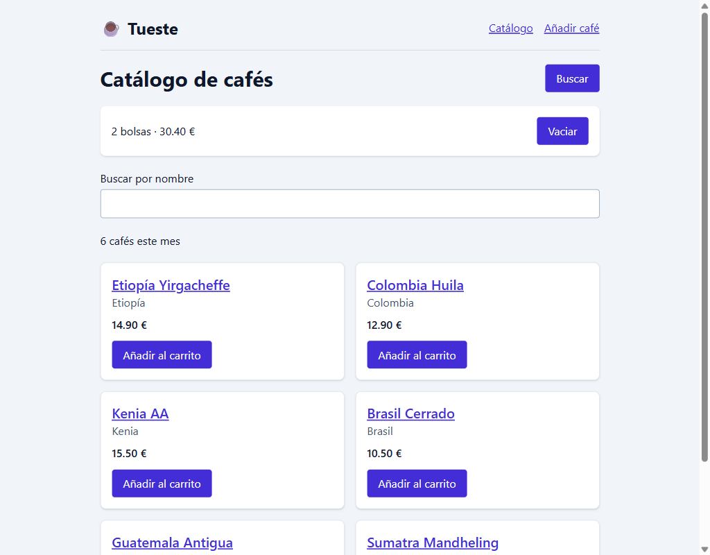
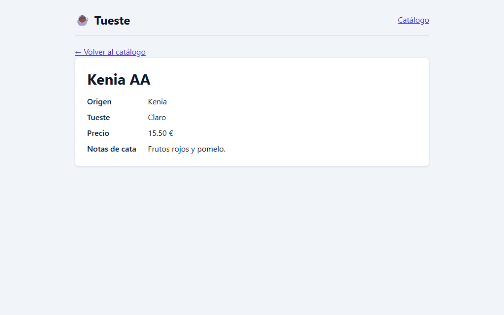
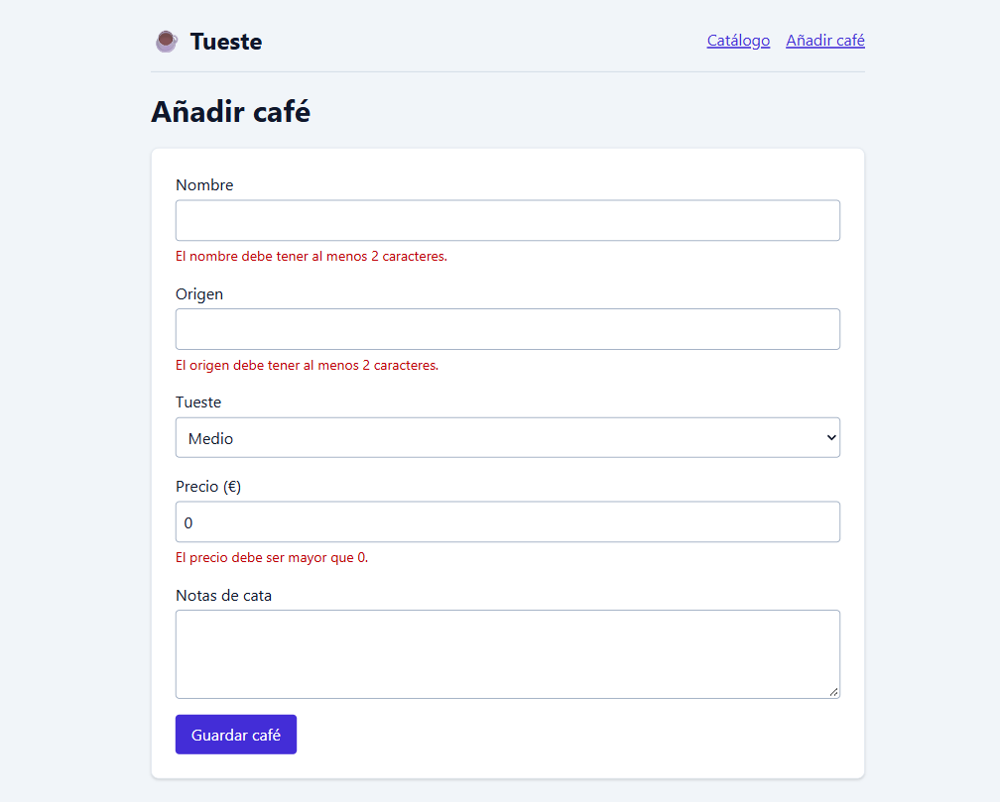
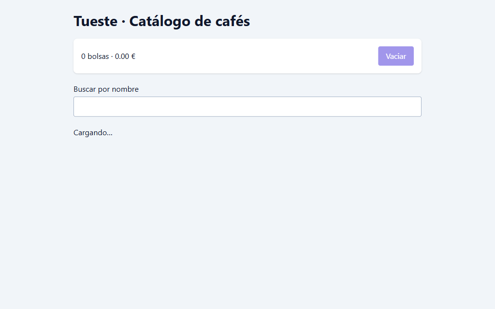

# ☕ Tueste · Catálogo de cafés

Laboratorio del módulo 04 (React): el catálogo del tostadero Tueste, con buscador y carrito, el detalle de cada café y formularios para dar de alta cafés nuevos y editarlos.

Stack: React 19, TypeScript 7 (estricto), Vite 8, Tailwind 4, TanStack Router (rutas por archivos), TanStack Form y Zod 4.

## Cómo arrancarlo

Necesita Node.js 22.12 o superior.

```bash
npm install      # instala las dependencias
npm start        # servidor de desarrollo de Vite
npm run build    # vite build && tsc --noEmit (genera routeTree.gen.ts y comprueba los tipos)
```

Para ver el build de producción: `npm run preview`.

## Mapa de la aplicación

| Ruta | Qué muestra |
|---|---|
| `/` | Redirige a `/coffees` |
| `/coffees` | El catálogo: buscador por nombre, botón "Buscar" que lleva el foco al buscador, resumen del carrito ("N bolsas · total €") con "Vaciar", y las tarjetas de los cafés con "Añadir al carrito" |
| `/coffees/new` | Formulario para dar de alta un café; al guardar, abre su detalle |
| `/coffees/$coffeeId` | Detalle de un café (origen, tueste, precio y notas de cata), con enlace para volver y para editar. Si no existe: "Café no encontrado" |
| `/coffees/$coffeeId/edit` | El mismo formulario con los datos del café; al guardar conserva el id y vuelve al detalle. Si no existe: "Café no encontrado" |
| Cualquier otra | "Página no encontrada" |

Los cafés iniciales se leen de `public/coffees.json`; los que se crean o editan se guardan en `localStorage` (clave `tueste-coffees`). Si se borra esa clave, vuelven los 6 cafés iniciales.

### Organización del código

```
src/
  routes/              sólo navegación: leen parámetros y pintan una escena
  core/router/         crear y registrar el router
  core/coffees/        modelo, esquema de Zod, api y hooks (lo comparten los dos pods)
  layouts/             navegación + <Outlet />
  scenes/              componen una pantalla y deciden adónde navegar
  pods/catalogo/       lista, buscador, carrito y detalle (container + component)
  pods/edicion/        formulario de alta y edición (container + component)
  common/components/   mensajes de carga y error
```

Ningún pod importa al otro, y las escenas sólo importan cada pod desde su `index.ts`.

## Capturas

**Catálogo con el carrito**



**Detalle de un café**



**Formulario mostrando errores**



**Pantalla de "Cargando…"**



## Respuestas

### O1 · El catálogo con componentes

**¿Qué aviso da React sin key y para qué la necesita?**

Sin key, React muestra en la consola el aviso "Each child in a list should have a unique "key" prop". La key identifica cada elemento de la lista entre un render y el siguiente: así React sabe qué elemento es cada uno y sólo añade, quita o actualiza en el DOM los que han cambiado, en lugar de volver a pintar la lista entera o de mezclar el estado de unos elementos con el de otros.

**¿Por qué usáis coffee.id y no el índice del map?**

El índice indica la posición en el array, no qué café es: si la lista se filtra, se reordena o se borra un elemento, el mismo índice pasa a corresponder a otro café y React reutilizaría el DOM y el estado de una tarjeta para el café equivocado. coffee.id es único y no cambia, así que cada tarjeta queda siempre asociada a su café.

### O2 · Un carrito con estado y eventos

**¿Por qué escribís onAdd={addToCart} y no onAdd={addToCart()}?**

Con onAdd={addToCart} pasamos la función a la tarjeta para que la llame ella cuando se pulse el botón.
Con onAdd={addToCart()} la estaríamos ejecutando durante el render y pasaríamos su resultado (undefined), no la función: además de no funcionar, actualizaría el estado en cada render, lo que provoca otro render y un bucle infinito (React lo corta con el error "Too many re-renders").

**¿Por qué el total del carrito no necesita su propio useState? ¿Qué problema podríais tener si lo fuera?**

Porque se puede calcular a partir de cart, que ya es estado: cada vez que cart cambia, App se vuelve a renderizar y el reduce recalcula el total.
Si fuera un estado aparte, habría dos fuentes de verdad que mantener sincronizadas a mano: bastaría con olvidar actualizar el total en algún sitio (por ejemplo, al vaciar) para que no coincidiera con el carrito, y si se sincronizara con un useEffect se pintaría primero el total antiguo y habría un render extra.

### O3 · Cargar los cafés con useEffect

**¿Por qué la petición va dentro de un useEffect y no directamente en el cuerpo del componente?**

El cuerpo del componente se ejecuta en cada render y tiene que limitarse a calcular qué se pinta.
Si el fetch estuviera ahí, se lanzaría una petición en cada render, y como al recibir los datos llamamos a setCoffees, eso provocaría otro render y otra petición: un bucle infinito.
useEffect sirve para sincronizar el componente con algo externo (aquí, el servidor): se ejecuta después de pintar y sólo cuando cambian sus dependencias, y además permite devolver una función de limpieza (nuestro controller.abort()) que cancela la petición si el componente se desmonta.

**¿Qué significa el [] del final?**

Es el array de dependencias: React vuelve a ejecutar el efecto sólo si alguno de esos valores ha cambiado desde el render anterior. Vacío significa que el efecto no depende de nada del componente, así que se ejecuta una sola vez al montarlo (y la limpieza al desmontarlo).
En desarrollo, StrictMode lo monta, desmonta y vuelve a montar a propósito, por eso en Network aparece una primera petición cancelada y una segunda que sí termina.

### O4 · Un custom hook y una ref

**Si dos componentes distintos llaman a useCoffees(), ¿comparten los mismos datos o cada uno tiene los suyos? ¿Cuántas peticiones se hacen?**

Cada uno tiene los suyos. Un custom hook reutiliza la lógica, no el estado: cada componente que llama a useCoffees() crea sus propios useState y su propio useEffect, como si hubiera escrito ese código dentro de él.
Por eso se hacen dos peticiones a /coffees.json, una por componente (en desarrollo, con StrictMode, se ve además una cancelada por cada uno).
Si quisiéramos compartir los mismos datos con una sola petición, habría que subir el estado a un componente común y pasarlo por props o Context, o usar una caché de datos.

**¿Por qué el foco se hace con una ref y no con un estado?**

Porque dar el foco no cambia lo que se pinta: es una orden puntual al elemento del DOM (input.focus()), no un dato del que dependa el render.
Un estado provocaría un render que no hace falta y aun así no daría el foco por sí solo. La ref guarda una referencia al input que se mantiene entre renders y cambiarla no provoca un render nuevo, que es justo lo que necesitamos para acceder al elemento real del DOM.

### O5 · Lista y detalle con TanStack Router

**¿Qué ganamos con una URL por pantalla frente a mostrar el detalle con un booleano en el estado?**

Con un booleano en el estado, la pantalla que se ve sólo existe en la memoria del componente: al recargar se pierde, no se puede compartir ni guardar en marcadores, y los botones Atrás y Adelante del navegador no hacen nada.
Con una URL por pantalla (/coffees/3), la URL es la fuente de verdad: se puede recargar, enlazar o abrir directamente, el historial del navegador funciona solo y cada ruta lee lo que necesita de sus parámetros.
Además, con TanStack Router los enlaces y los parámetros están tipados: si escribimos mal una ruta o un parámetro, TypeScript da error.

**Según la comprobación 5: ¿por qué se ha vaciado el carrito? ¿Dónde tendría que vivir ese estado para no perderse?**

El estado cart vive en el componente de la ruta /coffees. Al navegar al detalle, ese componente se desmonta y React descarta su estado; al volver se monta de nuevo y useState arranca otra vez con el valor inicial, [].
Para que no se pierda, tendría que vivir en un componente que no se desmonte al cambiar de ruta, como el layout de __root.tsx, y llegar a quien lo necesite por props o, mejor, con Context.

### O6 · Alta de cafés con TanStack Form y Zod

**Ya teníais la interfaz Coffee en TypeScript. ¿Para qué hace falta además un esquema de Zod?**

Los tipos de TypeScript sólo existen al compilar: se borran al generar el JavaScript, así que en el navegador no comprueban nada de lo que escribe la persona en el formulario.
El esquema de Zod sí se ejecuta: valida los valores reales en tiempo de ejecución, con reglas que un tipo no puede expresar (al menos 2 caracteres, sin espacios a los lados, precio mayor que 0, como mucho 120 caracteres) y con un mensaje de error para cada una que el formulario enseña junto a su campo.
Además, al hacer parse nos devuelve los datos ya limpios (con el trim aplicado), y como el esquema está en un único fichero, cualquier formulario que lo use aplica las mismas reglas.

**¿Por qué el precio necesita valueAsNumber? ¿Qué pasaría con el esquema si llegase como texto?**

Un input, aunque sea type="number", siempre devuelve su contenido como texto en event.target.value: si escribimos 12.5 llega "12.5". valueAsNumber lo convierte en el número 12.5 (o en NaN si el campo está vacío), que es lo que espera el modelo Coffee.
Si llegase como texto, la regla z.number() del esquema fallaría siempre, incluso con un precio correcto, y el formulario no se podría enviar nunca. Y si no lo validáramos, guardaríamos un string donde debería ir un número, y operaciones como el total del carrito (sum + coffee.price) concatenarían texto en vez de sumar.

### O7 · Edición y organización en pods

**Imaginad estos tres cambios: el diseño de la tarjeta de café, la regla de validación del precio y adónde se va después de guardar. ¿En qué fichero haríais cada uno?**

El diseño de la tarjeta, en src/pods/catalogo/coffee-card.component.tsx: es un component que sólo recibe el café por props y lo pinta, así que el cambio no toca datos ni lógica.
La regla del precio, en src/core/coffees/coffee.schema.ts: el esquema vive en core porque lo comparten el alta y la edición, y al cambiarlo ahí los dos formularios aplican la regla nueva a la vez.
Adónde se va después de guardar, en las escenas: src/scenes/new-coffee.scene.tsx para el alta y src/scenes/edit-coffee.scene.tsx para la edición, que son las que pasan el onSaved con el navigate. El formulario no sabe adónde va, así que no hay que tocarlo.

**¿Qué ventaja tiene separar el container del component? ¿Lo haríais en todos los componentes?**

Cada pieza tiene una sola responsabilidad: el container sabe de dónde vienen los datos (hooks, API, estado) y decide qué mostrar (cargando, error, no encontrado o el contenido), y el component sólo recibe props y pinta.
Así el component es más fácil de entender, de reutilizar (el mismo CoffeeForm sirve para alta y edición con containers distintos) y de probar, porque basta con pasarle props sin servidor ni localStorage; y si cambia la forma de obtener los datos, sólo cambia el container.
No lo haría en todos: en piezas pequeñas que no piden datos, como CoffeeCard, LoadingMessage o ErrorMessage, un container sólo añadiría un fichero más sin aportar nada. Tiene sentido cuando un componente necesita datos o estado y además una parte de presentación que merece separarse.

## Checklist

### ✅ Obligatorios

- [x] O1 · El catálogo con componentes
- [x] O2 · Un carrito con estado y eventos
- [x] O3 · Cargar los cafés con useEffect
- [x] O4 · Un custom hook y una ref
- [x] O5 · Lista y detalle con TanStack Router
- [x] O6 · Alta de cafés con TanStack Form y Zod
- [x] O7 · Edición y organización en pods
- [x] O8 · README + bitácora de IA

### ⭐ Opcionales

- [ ] P1 · Un carrito que no se pierde
- [ ] P2 · Y que sobreviva también a recargar
- [ ] P3 · Una cuenta atrás para la oferta
- [ ] P4 · Filtros que viven en la URL
- [ ] P5 · Memorizar… con cabeza
- [ ] P6 · CSS Modules
- [ ] P7 · Eliminar un café

### 🔥 Desafíos

- [ ] D1 · Una búsqueda con debounce
- [ ] D2 · React Compiler
- [ ] D3 · Un contrato de API distinto
- [ ] D4 · Tests de componentes
- [ ] D5 · Hacia TanStack Start

## 🤖 Bitácora de IA

Herramientas: **Claude Code** (modelo Claude Opus 5.5) desde VS Code, para escribir el código y las respuestas paso a paso, y un navegador Chrome controlado por la propia IA (Chrome DevTools) para repetir las comprobaciones 🔎 y sacar las capturas. Cada obligatorio se revisó y se probó antes de hacer su commit.

### Prompt

"Hago la primera comprobación y con 3G no se ve 'Cargando' antes de la lista" (O3)

### Qué me dio

En lugar de cambiar el código, midió lo que pasaba en un navegador con Slow 3G y la caché desactivada: la página estaba en blanco unos 79 s y "Cargando…" sólo se veía unos 2 s antes de la lista. La explicación: con `npm start`, Vite sirve el código sin empaquetar y el navegador descarga decenas de módulos uno a uno, mientras que `coffees.json` pesa menos de 1 KB. Después intentó sacar la captura de "Cargando…" con la misma red lenta y dos veces le salió la lista ya cargada, porque la herramienta esperaba a que terminase la carga antes de capturar.

### Qué corregí y por qué

No tocamos el componente: el estado `loading` estaba bien y el problema era el entorno de desarrollo. Lo comprobé con `npm run build` y `npm run preview` (un único fichero JS), donde "Cargando…" sí se ve. Para la captura descartamos los intentos con red lenta y, sólo en el navegador de pruebas, se retuvo la respuesta de `coffees.json` hasta hacer la foto: la pantalla es el estado de carga real del componente, sin cambiar el código de la aplicación. Aprendí a no "arreglar" código que funciona antes de entender si el fallo es del código o de cómo lo estoy probando.

### Prompt

"Responde a las preguntas de O1" (con el array de O1 todavía con el cuarto café que añadí en la comprobación 🔎 2)

### Qué me dio

Las respuestas sobre `key` y, además, la recomendación de quitar el cuarto café (Brasil Cerrado) de `app.tsx` antes del commit, porque O1 pide "tres cafés escritos a mano". También señaló que lo había pegado con las claves entre comillas, como en el JSON.

### Qué corregí y por qué

Dejé el cuarto café: la comprobación pide añadirlo para ver que el número cambia solo, pero en ningún sitio pide quitarlo después, y en O3 ese array desaparece de todas formas. La IA dio por hecho un requisito que el enunciado no pone. Lo que sí arreglé fueron las comillas de las claves, para que el objeto tuviera el mismo estilo que los otros tres.

### Prompt

"Commit hecho. Sigue con O5"

### Qué me dio

Un lote de cambios en muchos ficheros a la vez (plugin del router, rutas, `api.ts`, hooks, `main.tsx` y la tarjeta). Un hook de seguridad del editor bloqueó la mayoría en el primer intento y sólo dejó pasar algunos: en `coffee-card.tsx` se aplicó el `<Link>` en el nombre del café, pero no el `import { Link }` correspondiente, así que el fichero quedó usando `Link` sin importarlo.

### Qué corregí y por qué

Antes de compilar se repasó qué cambios se habían aplicado de verdad y cuáles no, se volvió a aplicar el import que faltaba y luego se comprobó con `npm run build`, que desde O5 es `vite build && tsc --noEmit`. La lección es no dar por bueno un cambio de la IA porque "lo ha dicho": cuando toca varios ficheros, alguno se puede quedar a medias, y el build con `tsc` es la red de seguridad que lo detecta.
